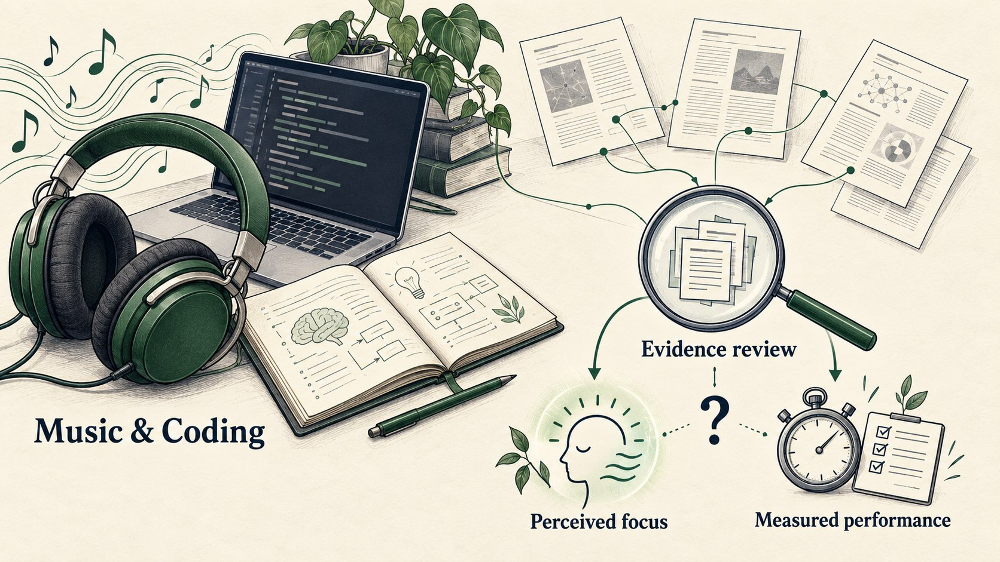
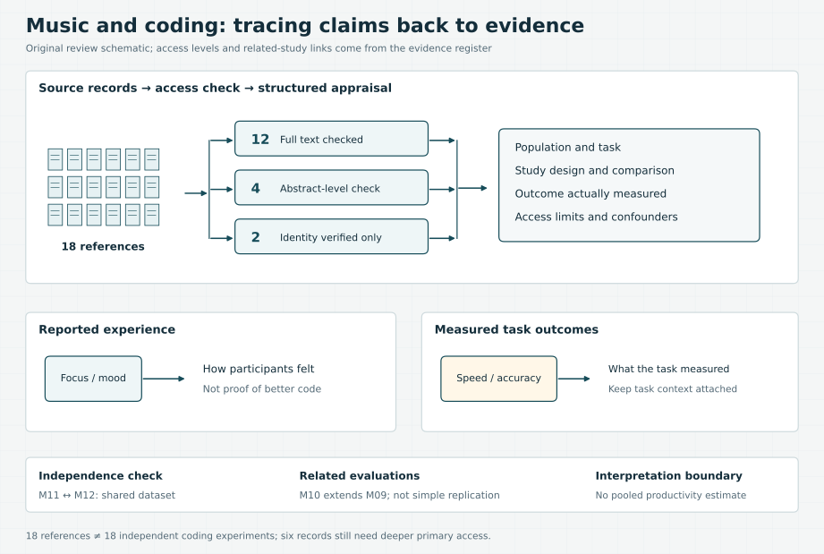

# Does Music Help You Code?



*Conceptual illustration: evidence review separates perceived focus from measured performance.*

[](https://github.com/kasra-mohebian/music-and-coding-focus/actions/workflows/checks.yml)

**Evidence on background music, developer focus and task performance.**

A research review for developers who work with music. It follows 18 references across programming, systems analysis, attention and learning, asking a practical question: when music feels helpful, does the evidence also show better task performance?

The answer depends on the task and the outcome being measured. Developer surveys describe perceived benefits; small programming pilots remain inconclusive; some attention studies find a change in reported focus without a corresponding speed improvement.

## Key findings

| Finding | Evidence | What it means |
|---|---|---|
| Developers report benefits from music during remote work | [M01](REFERENCES.md#m01), survey | Useful evidence about experience; no controlled improvement in code quality |
| A small EEG programming pilot was inconclusive about music | [M04](REFERENCES.md#m04) | Pair-programming findings must not be mistaken for music findings |
| Music changed mood without an apparent improvement in systems-analysis model quality | [M07](REFERENCES.md#m07), abstract-level check | Feeling better and performing better are different outcomes |
| Preferred music improved reported focus without a significant mean reaction-time improvement | [M11](REFERENCES.md#m11), attention task | A general attention finding does not establish a coding-performance gain |
| Faster/positive music helped some cognitive outcomes relative to other music conditions | [M13](REFERENCES.md#m13) | No silence baseline: this cannot show that music beats silence |

**Overall:** the evidence supports context-sensitive choices, not a universal playlist, BPM range or guaranteed productivity boost. Read the [briefing](docs/briefing.md) for the reasoning and the [study appraisals](docs/study-appraisals.md) for source-level details.

## Explore the research

| Artifact | What you can inspect |
|---|---|
| [Review protocol](docs/protocol.md) | Research questions, search plan, relevance rules and appraisal criteria |
| [Evidence register](evidence/studies.csv) | 18 records with population, design, outcome, limitations, access level and source locator |
| [Study appraisals](docs/study-appraisals.md) | A readable assessment of every reference, including related datasets |
| [Claim-to-evidence map](docs/claims.md) | Which conclusions are supported and where inference stops |
| [Research briefing](docs/briefing.md) | Synthesis and implications for programming work |
| [Presentation outline](docs/presentation.md) | Three slides explaining the question, evidence and conclusion |
| [References](REFERENCES.md) | Named scientific authors, corrected titles, DOIs and primary access links |



*Original evidence map: source access levels, separate outcomes and related-study boundaries.*

## How the review handles evidence

The 18 references are a reconstructed course bibliography, not 18 independent coding experiments. The source audit checked primary methods/results sections for 12 records; four were checked through abstracts or an abstract plus author slides; two have verified bibliographic identities only. The [appraisals](docs/study-appraisals.md#access-still-needed-for-a-full-text-appraisal) list the six sources needing deeper access.

M11 and M12 share a dataset. M10 extends M09 and adds evaluations. Both pairs are identified explicitly so related work is not counted as independent confirmation. Reading, calculation and perceptual-learning results are kept separate from programming evidence.

This project developed from a rapid course review. The public edition rebuilds the evidence trail with original summaries; it does not claim an exhaustive systematic search or a pooled effect estimate. The original external screening sheet was unavailable, so historical screening counts are not reconstructed from guesses.

## Validate the evidence register

Python 3.11+; no external packages or article downloads are required.

```bash
python3 scripts/check_evidence.py
```

This checks identifiers, required appraisal fields, DOI uniqueness, reciprocal related-study links and local citations. It validates the structure of the evidence trail, not scientific truth.

## Corrections and reuse

Source corrections and better primary access links are welcome. Cite the study ID and the relevant page or section; keep private data and copyrighted article attachments out of public issues. See [security and data handling](SECURITY.md).

Original review text and curated annotations: [CC BY 4.0](LICENSE.md). Validation code and workflow configuration: [MIT](LICENSE-code). Referenced papers retain their own terms; their PDFs, figures, participant quotations and teaching/submission files are not distributed here.

## Publication status

This is a personal portfolio repository, not an official publication of the University of Bamberg.
